# How RF-DETR Works

!!! tip "Key Takeaways"

    - RF-DETR treats detection as a set of answers to a fixed number of learned questions (queries), so it learns to suppress duplicate boxes and needs no non-maximum suppression (NMS)
    - Its backbone is DINOv2, a vision transformer pretrained without labels, which is why it adapts well to small and unusual datasets
    - Windowed attention keeps the backbone cheap, and deformable attention lets each query read only a few points of the image instead of all of them
    - Training uses one-to-one Hungarian matching, which is what teaches the model not to produce duplicates
    - For instance segmentation, each query also paints its own mask: a dot product between the query and a shared map of pixel features, so mask, box and class always describe the same object
    - For keypoints, each object query brings its own team of keypoint queries through every decoder layer; each keypoint predicts where it is, whether it can be found and seen, and how uncertain its location is
    - In the RF-DETR paper, one training run covers the Nano through Large sizes as points on a single accuracy–latency curve

This page builds the idea up from scratch, one picture at a time. No prior knowledge of transformers is assumed. If you only want numbers, go to [Benchmarks](benchmarks.md); if you want to train, go to [Train Model](train/index.md).

## A question to start with

Look at a photo of a street. You see a cyclist, two cars, and a dog. You did not consider ten thousand possible boxes and then throw most of them away. You just *saw* four things.

How do you get a computer to give that kind of answer: a short list, one entry per object, and nothing else?

There are two broad philosophies.

{ loading=lazy }

### Guess everywhere, then clean up

Classic convolutional detectors, such as YOLOv8 and YOLO11, slide a network over the image and make a prediction at every cell of a grid, often at several scales. Each cell says "if there is an object centered near me, here is its box and its class." Most cells see nothing, a few see something, and several neighboring cells usually see *the same* thing.

The result is thousands of candidate boxes with heavy overlap. A hand-written post-processing step, non-maximum suppression (NMS), then walks through them: keep the highest-scoring box, delete every other box that overlaps it by more than some threshold, repeat.

This works well and is very fast on a GPU. It also has a few properties worth noticing:

- NMS is not learned. Its IoU threshold is a knob you tune, and the right value changes between datasets. Too low and you delete one of two people standing close together; too high and you keep duplicates.
- Its cost depends on how many candidates survive the score filter, so a crowded scene takes longer than an empty one.
- It sits outside the network, so the model is never trained to avoid duplicates. It is trained to produce them and rely on the cleanup.

### Ask a fixed number of questions

In 2020, [DETR](https://arxiv.org/abs/2005.12872) proposed a different framing: detection as *direct set prediction*. The model holds a small, fixed set of learned **queries**. Think of each one as a question: "Is there an object I should be responsible for? If so, where, and what is it?" Every query answers once. A query with nothing to report answers "no object" (written ∅).

During training, each real object is assigned to exactly one query, and every other query is told the right answer for it was ∅. A query that tries to describe an object already claimed by another query is penalized. The network therefore learns not to produce duplicates, which removes the need for NMS and for hand-designed anchor boxes.

!!! question "Pause and ponder"

    If two queries both see the same cat, and only one of them is allowed to say "cat", how does the second one know to stay quiet? The queries need a way to talk to each other. Keep this in mind; it is exactly what the decoder's self-attention does.

The original DETR had two well-known weaknesses: it needed very long training schedules, and it struggled with small objects. [Deformable DETR](https://arxiv.org/abs/2010.04159) addressed both and reached better accuracy with 10 times fewer training epochs. RF-DETR inherits that fix, and adds several of its own to make the idea run in real time.

## Following one image through RF-DETR

Let us follow a single image through RF-DETR Small. Each step below is one box in this picture.

{ loading=lazy }

### Step 1: from pixels to tokens

The image is resized to a square, 512 × 512 pixels for RF-DETR Small, and cut into 16 × 16 pixel patches. That gives a 32 × 32 grid, so 1,024 patches. Each patch is flattened into a vector called a **token**. From here on the model never sees pixels, only this list of tokens and their positions.

Bigger models use larger inputs, and therefore more tokens:

| Model          | Resolution [px] | Patch size [px] | Tokens [-] | Decoder layers [-] | Queries [-] |
| :------------- | :-------------: | :-------------: | :--------: | :----------------: | :---------: |
| RF-DETR Nano   |       384       |       16        |    576     |         2          |     300     |
| RF-DETR Small  |       512       |       16        |   1,024    |         3          |     300     |
| RF-DETR Medium |       576       |       16        |   1,296    |         4          |     300     |
| RF-DETR Large  |       704       |       16        |   1,936    |         4          |     300     |

More tokens means finer detail, which helps with small objects, at the cost of more computation.

### Step 2: a backbone that already knows what things look like

The tokens go through the backbone, a vision transformer initialized from [DINOv2](https://arxiv.org/abs/2304.07193). DINOv2 was pretrained without any labels, on a large curated image collection, to produce general-purpose visual features. Before RF-DETR has seen a single bounding box, its backbone already separates fur from metal, edges from texture, and foreground from background.

This matters most when your dataset is small or unusual. The RF-DETR paper reports that initializing from DINOv2 "significantly improves detection accuracy on small datasets" compared with the backbone LW-DETR used.

A transformer block lets every token compare itself with every other token. That is powerful, because a patch on a car's wheel can directly consult a patch on its roof, but the cost grows with the square of the number of tokens. RF-DETR keeps it affordable with **windowed attention**:

{ loading=lazy }

Most blocks split the token grid into 2 × 2 windows, and each token only looks inside its own window. That cuts the number of comparisons per block by a factor of four. A few blocks stay global, so information can still cross window borders. In RF-DETR Small, 3 of the 12 blocks are global.

!!! note "Compare with a convolution"

    A 3 × 3 convolution only looks at immediate neighbors. A convolutional network sees the whole image only after many layers, as its receptive field slowly grows. A global attention block gets there in one step. This is one reason transformer detectors handle context well, for example recognizing a small object from what surrounds it.

### Step 3: the projector

Features are taken from four depths of the backbone (after blocks 3, 6, 9, and 12). Early blocks carry fine, local detail; late blocks carry more abstract meaning. The **projector** fuses the four into a single feature map at stride 16, using small convolutional C2f blocks with LayerNorm. This fused map is called the **memory**: it is what the decoder will read from.

Two details here are easy to miss:

- **There is no separate transformer encoder.** DETR and Deformable DETR run a stack of encoder layers after the backbone. In RF-DETR, as in LW-DETR, the pretrained ViT and the projector do that job.
- **LayerNorm instead of BatchNorm.** The paper uses layer norm in the projector so that training with gradient accumulation on consumer GPUs behaves correctly; batch norm statistics depend on the per-step batch size.

### Step 4: choosing where to look

Now we need to choose where those learned queries should look. RF-DETR uses a **two-stage** scheme: every memory token makes a quick class score and box proposal, and the 300 highest-scoring proposals initialize the learned queries' reference boxes.

So a query does not start with "is there anything out there?" It starts with "I think there is an object in roughly this box; let me check."

### Step 5: the decoder, where queries look and negotiate

The decoder is a short stack of layers (three for Small). Each layer does three things to every query:

1. **Self-attention between queries.** Queries compare notes. This answers the "pause and ponder" question above: two queries that latched onto the same dog can see each other, and over training they learn that only one of them should claim it.
2. **Cross-attention into the memory.** Each query reads image evidence. Here is the second efficiency trick.
3. **A box prediction.** The query predicts how to shift and resize the reference box from Step 4 into its own box.

{ loading=lazy }

In the original DETR, cross-attention let every query read every location of the feature map. RF-DETR uses **deformable attention**: each query predicts a few sampling offsets around its reference box and reads only those points. In RF-DETR Small that is 16 attention heads × 2 points = 32 samples per query, no matter how large the image is.

In the released RF-DETR models, every layer reads around the same reference box from Step 4. What each layer refines is the query content, and each layer predicts its box afresh from that anchor. You can still watch the predictions fit the object more closely: the proposal from Step 4, then layer 1, layer 2, layer 3.

### Step 6: reading the answer

The last decoder layer gives, for each of the 300 queries, a class score and a box. RF-DETR keeps the highest-scoring query and class pairs, and you apply your confidence threshold. That is the whole post-processing step. No NMS, and no IoU threshold to tune.

```python
from rfdetr import RFDETRSmall

model = RFDETRSmall()
detections = model.predict("https://media.roboflow.com/dog.jpg", threshold=0.5)
```

Segmentation models add a head that turns each query into a mask; the rest of the pipeline is the same. Keypoint models go one step further and give every query a team of keypoint queries that runs through the decoder with it. [From boxes to masks](#from-boxes-to-masks-instance-segmentation) and [From boxes to keypoints](#from-boxes-to-keypoints-pose-estimation) below show how each works.

## How it learns: matching, not sorting

Training is where the "one answer per object" behavior comes from. For each training image, RF-DETR has 300 predictions and, say, 3 ground-truth objects. Which prediction should be compared with which object?

{ loading=lazy }

RF-DETR builds a cost for every (query, object) pair from three terms: how wrong the class is, the L1 distance between the boxes, and their generalized IoU (GIoU). The Hungarian algorithm then finds the cheapest assignment in which every object gets exactly one query. Matched queries are trained toward their object. All other queries are trained toward ∅.

Look at query 3 in the picture. It is a good guess for object A, but query 2 is a better one. So query 3 is told "no object." That is the mechanism that suppresses duplicates: the network is penalized for them during training, so it learns not to produce them. Nothing enforces this at inference, so it is a learned tendency, not a guarantee.

Three further training details make this converge fast enough to be practical:

- **Group DETR.** During training RF-DETR uses 13 independent groups of queries, each matched to the ground truth on its own. Every object therefore gets 13 positive queries per image instead of one, which is much more learning signal. At inference only one group of 300 queries is used, so this costs nothing at deployment time.
- **IoU-aware classification.** The classification target for a matched query is not a plain 1. It blends the predicted score with the IoU of the predicted box, so the model learns to be confident in proportion to how well its box fits. Scores then rank boxes by quality as well as by class.
- **A loss on every decoder layer.** Each decoder layer's output is supervised directly. One consequence is that later layers can be removed at inference and the earlier ones still produce useful boxes, which the next section relies on.

## From boxes to masks: instance segmentation

A box says roughly where an object is. Instance segmentation asks for its exact pixels, and keeps every object separate: two dogs lying on top of each other get two masks, not one "dog" region. RF-DETR-Seg does this without changing anything above. The backbone, the projector, the queries, the decoder and the matching all stay. One small head is added, and every query that claims an object also paints that object's mask.

{ loading=lazy }

### A mask is a dot product

The memory from Step 3 is too coarse for a mask: it holds one feature per patch. The segmentation head first upsamples it to a quarter of the input resolution, so the 384 × 384 input of RF-DETR-Seg Small becomes a 96 × 96 grid. A few small convolutional blocks, one per decoder layer, then refine it into **pixel features**. Each block is a depthwise 3 × 3 convolution followed by LayerNorm and a pointwise layer.

The decoder already gives every query an embedding: the same vector that predicts its box and class. A small MLP adapts it for the mask. The mask logit at a pixel is then the dot product of that query embedding with the pixel's feature, plus one learned bias. A positive logit means "this pixel belongs to my object".

Two consequences fall out of this design:

- **All masks come from one matrix multiplication.** The pixel features are computed once per image and shared by every query. A mask costs one dot product per pixel, not a separate network run per object.
- **Masks never need to be paired with boxes.** Mask, box and class come from the same query embedding, so they always describe the same object. Just as there is no NMS, there is no step that assigns masks to detections afterwards.

!!! question "Pause and ponder"

    The pixel features know nothing about any particular object; they are shared by all queries. So what makes the dog query light up only the dog's pixels, and not the cat's? The answer is in the query embedding: after self-attention with the other queries and cross-attention into the image, it encodes *which* object it claimed, and the dot product matches pixels that look like that object.

### How the masks are learned

Masks enter training in two places:

- **Matching.** The cost of a (query, object) pair gains two mask terms next to the class, L1 and GIoU terms: a binary cross-entropy between the predicted and the true mask, and a Dice cost. A query whose box looks right but whose mask covers the wrong pixels becomes a worse match.
- **The loss.** Each matched query is trained with the same two terms. Binary cross-entropy scores every pixel on its own. Dice scores the overlap of the whole shape, so a small object with few pixels still counts.

Comparing every pixel of every mask with its target would be expensive, so training compares them at sampled points, an idea from [PointRend](https://arxiv.org/abs/1912.08193). For matching, the head samples shared pixel features before evaluating each query's dot product. For the loss, it first builds dense logits for matched queries and then evaluates sampled points from those logits. By default, the loss samples about one point per 16 mask pixels, with at least as many points as the mask has rows. Three quarters of the points go where the prediction is least certain, usually along object boundaries; the rest are spread at random.

As with boxes, every decoder layer gets its own mask, and each one is supervised directly.

### Reading the masks

At inference, the queries scoring below your confidence threshold are dropped first. Only the remaining masks are upsampled to the original image size and cut at logit 0, which turns them into boolean masks. That ordering means a higher threshold also saves mask memory and time. There is still no NMS. Two overlapping objects are two queries, so they get two masks, and a pixel can belong to both.

```python
from rfdetr import RFDETRSegSmall

model = RFDETRSegSmall()
detections = model.predict("https://media.roboflow.com/dog.jpg", threshold=0.5)
detections.mask  # boolean array, one (H, W) mask per detected object
```

The segmentation models use 12 pixel patches instead of 16, so their memory is finer at the same resolution. They also use fewer queries than detection at the small sizes:

| Model              | Resolution [px] | Patch size [px] | Tokens [-] | Decoder layers [-] | Queries [-] | Mask grid [-] |
| :----------------- | :-------------: | :-------------: | :--------: | :----------------: | :---------: | :-----------: |
| RF-DETR-Seg Nano   |       312       |       12        |    676     |         4          |     100     |    78 × 78    |
| RF-DETR-Seg Small  |       384       |       12        |   1,024    |         4          |     100     |    96 × 96    |
| RF-DETR-Seg Medium |       432       |       12        |   1,296    |         5          |     200     |   108 × 108   |
| RF-DETR-Seg Large  |       504       |       12        |   1,764    |         5          |     200     |   126 × 126   |

## From boxes to keypoints: pose estimation

Keypoint detection, also called pose estimation, asks for a fixed list of named points on every object. For a person in COCO that is 17 points: nose, eyes, ears, shoulders, elbows, wrists, hips, knees and ankles. Each point needs a location, and also an answer to a second question: is it there at all? A wrist behind someone's back still has a place you could guess, but you cannot see it.

RF-DETR Keypoint keeps the backbone, the projector, the object queries, the matching, and the absence of NMS. What changes is the decoder. The mask head reads each query once, after the decoder has finished. Keypoints get queries of their own, which travel through every decoder layer next to the object query they belong to. The design follows [Group Pose](https://arxiv.org/abs/2308.07313).

![Every object query is joined by 17 keypoint queries, one per keypoint type, which start from learned vectors adjusted by that object query. In each of the 4 decoder layers the group first runs self-attention among the object query and its own keypoint queries only, then every keypoint query reads a second memory with deformable attention around the object's reference box, then a feed-forward layer updates it. After every layer a small MLP reads the keypoint queries and places 17 keypoints inside the object's box.](../assets/how-it-works/keypoints.svg){ loading=lazy }

### A team of queries for every object

Each object query is joined by one keypoint query per keypoint type, so 17 for a COCO person. They start from 17 learned vectors shared by every object, and each object query scales and shifts them for its own object. That adjustment starts switched off, so early in training the keypoint queries are plain learned "nose", "left eye", "right eye" vectors. A learned position embedding per keypoint type keeps the left wrist apart from the right wrist even where the image looks symmetric.

In every decoder layer, once the object query has done its own self-attention, cross-attention and feed-forward steps from Step 5, the keypoint queries take three steps of their own:

1. **Group self-attention.** An object query and its 17 keypoint queries attend to each other, and to nobody else. A wrist query can consult the elbow and the shoulder of the same person, never those of another person. The object query hears back from its keypoints too, through a learned scale that starts near zero, so detection is left undisturbed early in training.
2. **Deformable cross-attention into a second memory.** Keypoint queries read the image the same way object queries do, a few learned sampling points each, but from a separate feature map built by a second projector, so boxes and keypoints do not have to share one set of features. Every keypoint query samples around its object's reference box from Step 4 and learns where inside that box to look.
3. **A feed-forward layer**, applied to each keypoint query on its own.

Group Pose also lets keypoint queries of the same type attend across people, all left wrists together. The preview model leaves that step out, so information flows between people only through the object queries' own self-attention.

A custom dataset can define several object classes, each with its own list of keypoints. Every object query then carries keypoint queries for every class, keypoints of different classes never attend to each other, and only the list belonging to the predicted class is used.

### What each keypoint predicts

![A person inside its dashed reference box, with 17 keypoints. Each keypoint query predicts its location as an offset from the box center in units of the box size; a findable probability, whether an annotator could place the point at all; a visible probability, whether it is in plain sight, so a hidden ankle is findable but not visible; three numbers for an uncertainty ellipse, small around the shoulders and large around the hidden ankle; and a class vote that is summed over the keypoints and added to the object's class score. At inference, wide ellipses lower the object's score.](../assets/how-it-works/keypoint-output.svg){ loading=lazy }

After every decoder layer, a small MLP reads each keypoint query and predicts eight numbers:

- **Location (2).** An offset from the center of the object's reference box, measured in units of the box's width and height. Keypoints are placed relative to their object, so the same offsets describe a person close to the camera and one far away.
- **Findable (1).** The probability that an annotator could place this point at all. In COCO terms, the point is labeled, whether it is in plain sight or occluded (visibility flag above 0).
- **Visible (1).** The probability that the point is in plain sight (visibility flag 2). A hidden ankle is findable but not visible.
- **Uncertainty (3).** A 2D Gaussian around the location, drawn as an ellipse: its size says how sure the model is, and its tilt says in which direction it is unsure. The three numbers define a triangular factor of the Gaussian's inverse covariance, with the diagonal stored as logarithms so every prediction is a valid ellipse.
- **Class vote (1).** Summed over the object's keypoints and added to its class logit. A query whose keypoints line up like a person becomes a more confident "person".

!!! question "Pause and ponder"

    No annotation says how uncertain a keypoint is; datasets only give its position. So how can the model learn to draw a wide ellipse around a hidden ankle and a tight one around a shoulder? The answer is in the loss below.

### How keypoints are learned

The matching cost of a (query, object) pair keeps the class, L1 and GIoU terms and gains four keypoint terms. The loss uses the same four:

- **L1 distance** between the predicted and the true locations, divided by the square root of the object's box area and averaged over labeled keypoints. A 5 pixel miss counts for more on a small person than on a large one.
- **Binary cross-entropy on findable** and **on visible**, against the dataset's visibility flags.
- **Gaussian negative log-likelihood** of the true location under the predicted ellipse.

The last term is how the model learns its uncertainty without labels. A tight ellipse around the right spot is cheap. A tight ellipse around the wrong spot is very expensive. Widening the ellipse reduces the penalty for a location error, but increases a separate penalty for being vague; the total still depends on how far the prediction is from the true point. Over many images, the cheapest strategy is to draw tight ellipses where the model is reliably right and wide ones where it tends to miss.

Points that were not labeled (visibility flag 0) still train findable and visible, as points that cannot be found, but they do not train location or uncertainty. As with boxes and masks, the keypoints of every decoder layer are supervised directly.

### Reading the keypoints

At inference, the object score goes through one extra step before your threshold sees it: it is combined with the keypoint uncertainty. RF-DETR averages the size of the object's ellipses, weighting each by its findable probability so that a point that is probably not there counts less. Objects with wide ellipses then lose score, and objects with tight ones keep it. With the default strength of 0.2, a score `s` and a mean ellipse size `T` become `s · T^-0.2 / (1 + s · T^-0.2)`, which stays below 1.

That transformation puts keypoint scores on a different scale from detection scores, so choose the threshold for a keypoint model separately. To turn the fusion off and get the plain object score, pass `postprocess_trace_alpha=0.0` when you create the model.

```python
from rfdetr import RFDETRKeypointPreview

model = RFDETRKeypointPreview()
key_points = model.predict("/path/to/people.jpg", threshold=0.5)
key_points.xy  # (N, 17, 2) pixel coordinates, one row per person
key_points.keypoint_confidence  # (N, 17) probability that each point is findable
key_points.data["covariance"]  # (N, 17, 2, 2) uncertainty ellipses in pixels
```

Keypoint accuracy is measured with object keypoint similarity (OKS), the keypoint counterpart of box IoU: each predicted point scores by a Gaussian of its distance to the true point, scaled by the object's size and by a per-keypoint tolerance, since an eye must be placed more precisely than a hip. On COCO val2017 person keypoints, the preview model scores 71.8 AP50:95 at 9.7 ms on an NVIDIA T4 (TensorRT FP16, batch size 1); see [Run Keypoints](run/keypoints.md) for the comparison with YOLO pose models.

The keypoint model uses 12 pixel patches like the segmentation models, at a larger resolution:

| Model                    | Resolution [px] | Patch size [px] | Tokens [-] | Decoder layers [-] | Queries [-] | Keypoints [-] |
| :----------------------- | :-------------: | :-------------: | :--------: | :----------------: | :---------: | :-----------: |
| RF-DETR Keypoint Preview |       576       |       12        |   2,304    |         4          |     100     |      17       |

## One training run, a whole family of models

Most detector families are trained once per size. In the RF-DETR paper, the Nano through Large sizes come from a single training run, using weight-sharing neural architecture search (NAS). The Atto, Femto, and Pico models use a different backbone (PE-Core-T), and the XL and 2XL models have about 126 M parameters, so they cannot share weights with that family.

{ loading=lazy }

Five architecture knobs are varied: patch size, input resolution, number of attention windows, number of decoder layers, and number of queries. In the paper's words, "at every training iteration, we uniformly sample a random model configuration and perform a gradient update." The same weights therefore learn to work at every setting. After training, each configuration is evaluated on a validation set without any fine-tuning, and the best ones form a continuous accuracy–latency curve. In the paper, the Nano, Small, Medium, and Large sizes are points on that curve; as the table in Step 1 shows, they differ mainly in resolution and decoder depth. The grey dots in the chart are illustrative, not measured: they only suggest the other settings of the same weights.

You can run the same search on your own dataset on the [Roboflow platform](https://roboflow.com/).

## RF-DETR vs. convolutional detectors

| Question                    | Classic convolutional detector (YOLOv8, YOLO11)                                                                          | RF-DETR                                                                                                |
| :-------------------------- | :----------------------------------------------------------------------------------------------------------------------- | :----------------------------------------------------------------------------------------------------- |
| How many predictions?       | One per grid cell per scale, thousands in total                                                                          | A fixed set of 300 queries                                                                             |
| How are duplicates removed? | NMS after the network, with a tuned IoU threshold                                                                        | Learned during training through one-to-one matching; no NMS                                            |
| How far can a feature see?  | Grows layer by layer with the receptive field                                                                            | Whole image in one global attention block                                                              |
| Backbone pretraining        | Supervised, learned from labeled images                                                                                  | DINOv2, self-supervised on a large curated image collection                                            |
| Changing model size         | Train each size separately                                                                                               | One NAS run covers Nano through Large                                                                  |
| Parameters                  | Small (YOLO11-N: 2.6 M)                                                                                                  | Larger (RF-DETR-N: 30.5 M)                                                                             |
| License                     | AGPL-3.0 — closed-source commercial use needs a license ([included on Roboflow cloud](https://roboflow.com/ultralytics)) | Apache 2.0 — free for commercial use (Nano through Large detection, every segmentation size, Keypoint) |

What this buys you in practice, from the [Benchmarks](benchmarks.md) page (COCO val2017, NVIDIA T4, TensorRT FP16, batch size 1):

- **Accuracy at lower latency.** At 4.4 ms, RF-DETR-M scores 54.7 AP50:95 and YOLO26-M scores 52.5; YOLO26-L needs 5.7 ms to reach 54.1. At the top end, RF-DETR-L reaches 56.5 at 6.8 ms, while YOLO26-X reaches 56.9 but needs 9.6 ms and YOLO11-X reaches 50.9 at 10.5 ms.
- **Transfer to new domains.** On RF100-VL, an average over 100 diverse real-world datasets, RF-DETR-L scores 62.2 AP50:95 against 56.5 for YOLO11-L and 59.3 for YOLO26-L. The paper credits the DINOv2 backbone for part of the gain on small datasets, but this table does not isolate it: LW-DETR-L, built on a different backbone, also reaches 61.5.
- **No post-processing to tune or to port.** An exported model needs only a top-k score selection after the forward pass. Compared with the default YOLOv8 and YOLO11 export path, there is no NMS implementation to reproduce in ONNX, TensorRT, CoreML, or any other runtime.
- **A permissive license.** RF-DETR Nano through Large detection, every segmentation size and Keypoint are Apache 2.0, so you can ship them in a closed-source, commercial product, including self-hosted deployments, without paying a license fee or open-sourcing your code. YOLOv8, YOLO11 and YOLO26 are AGPL-3.0: using them in a commercial product or service, including one users reach over a network, means open-sourcing your application code under AGPL-3.0 or buying a commercial license. Deploying on Roboflow includes that license for every user; commercial self-hosting is an Enterprise add-on ([details](https://roboflow.com/ultralytics)).

The trade-offs are real as well:

- RF-DETR has many more parameters, so model files are larger. If memory or storage is your binding constraint, measure on your target device.
- At the very smallest size, YOLO26-N is faster (1.7 ms against 2.3 ms for RF-DETR-N), though less accurate (40.3 against 48.4 AP50:95).
- Inputs are resized to the configured inference shape, which defaults to a square. Custom inference and export shapes may be rectangular, but both dimensions must be divisible by patch size × number of windows.

## RF-DETR in the DETR family

RF-DETR is the latest step in a short lineage. Each model kept DETR's core idea, set prediction with one-to-one matching, and fixed a different bottleneck.

| Model                                               | Year | What it changed                                                                                                                |
| :-------------------------------------------------- | :--: | :----------------------------------------------------------------------------------------------------------------------------- |
| [DETR](https://arxiv.org/abs/2005.12872)            | 2020 | Detection as set prediction with bipartite matching; removes NMS and anchors. Slow to train, weak on small objects.            |
| [Deformable DETR](https://arxiv.org/abs/2010.04159) | 2020 | Each query attends to a few sampling points around a reference instead of the whole map; 10× fewer training epochs.            |
| [RT-DETR](https://arxiv.org/abs/2304.08069)         | 2023 | First real-time end-to-end detector: CNN backbone, efficient hybrid encoder, better query selection, adjustable decoder depth. |
| [LW-DETR](https://arxiv.org/abs/2406.03459)         | 2024 | ViT encoder, projector, and a shallow decoder; interleaved window and global attention.                                        |
| [D-FINE](https://arxiv.org/abs/2410.13842)          | 2024 | Predicts boxes as probability distributions refined layer by layer, with self-distillation from deep to shallow layers.        |
| [RF-DETR](https://arxiv.org/abs/2511.09554)         | 2025 | LW-DETR design with a DINOv2 backbone, LayerNorm projector, weight-sharing NAS, and segmentation and keypoint heads.           |

The closest relative is **LW-DETR**, which RF-DETR builds on. The paper lists what changed:

- **Backbone.** LW-DETR's CAEv2 backbone is replaced with DINOv2, which the paper reports outperforms CAEv2 by 2% and helps most on small datasets.
- **Normalization.** LayerNorm replaces BatchNorm in the projector, so gradient accumulation works on consumer GPUs.
- **Training recipe.** The paper's recipe limits augmentation to horizontal flips and random crops, and the per-size models come from NAS rather than separate training runs.

**RT-DETR** and **D-FINE** take a different route to real time: a convolutional backbone followed by a dedicated hybrid encoder. RF-DETR instead relies on a large pretrained ViT and has no separate encoder at all. On COCO, RF-DETR-N scores 48.4 AP50:95 against 42.7 for D-FINE-N, but at larger sizes D-FINE is slightly ahead: D-FINE-M scores 55.0 against 54.7 for RF-DETR-M, and D-FINE-L scores 57.2 against 56.5 for RF-DETR-L, at 1.0 ms and 0.7 ms more latency. On RF100-VL the two families are closer, with D-FINE-N slightly ahead at the smallest size (58.2 against 57.7) and RF-DETR-L ahead at the large size (62.2 against 61.6). The RF-DETR paper notes that RT-DETR beats D-FINE on RF100-VL AP50, which suggests D-FINE's hyperparameters may be tuned closely to COCO. That is the general lesson of the comparison: COCO alone does not tell you how a detector will behave on your data.

## Where to go next

- [Benchmarks](benchmarks.md): the full accuracy and latency tables behind the numbers on this page
- [Run Model](run/detection.md): use a pretrained model in a few lines
- [Run Segmentation](run/segmentation.md): predict instance masks with RF-DETR-Seg
- [Run Keypoints](run/keypoints.md): predict person keypoints with RF-DETR Keypoint
- [Train Model](train/index.md): fine-tune on your own dataset
- [Export Model](../exports/index.md): deploy to ONNX, TensorRT, CoreML, and other runtimes
- [RF-DETR paper](https://arxiv.org/abs/2511.09554): the full method and ablations
