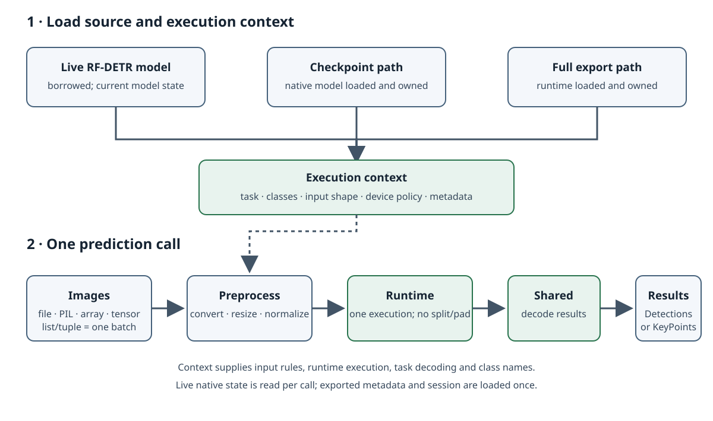

# Run Inference

`RFDETR.inference()` creates an independent predictor for native model inference, while `RFDETRInference` gives live models, checkpoints, and supported full exports one shared image-prediction API. The native factory snapshots the current model weights and prediction settings; later training or source mutations do not affect that predictor. Both paths use one runtime call per image batch and return decoded Supervision outputs.



## Choose a source

Use `model.inference()` when you want a predictor that owns an independent snapshot of a native model. It copies the current base weights, labels, normalization, and postprocessing settings once; subsequent training or source changes do not affect predictions or class names. Do not train or mutate the source concurrently with snapshot creation. Delete the predictor when finished to release its owned runtime. The source model remains unchanged.

```python
from rfdetr import RFDETRSmall

model = RFDETRSmall()
predictor = model.inference()
results = predictor.predict("image.jpg")
```

A `.pth`, `.pt`, or `.ckpt` path passed to `RFDETRInference` loads and owns a native model; an exported path loads and owns its runtime. Checkpoint loading may require architecture information available from the checkpoint name or supplied to `RFDETR.from_checkpoint()`. For a CPU-safe native predictor, create the snapshot without compilation:

```python
from rfdetr import RFDETR

model = RFDETR.from_checkpoint("checkpoint.pth", device="cpu")
predictor = model.inference(compile=False)
results = predictor.predict("image.jpg")
```

The native factory defaults to TorchScript compilation, batch size 1, and float32. Pass `compile=False` for a CPU-safe eager predictor. Compilation settings such as `batch_size`, `dtype`, and `compile_backend` belong to each returned predictor; the factory does not change the source model. The removed `inplace` keyword is rejected. `remove_optimized_model()` and `is_optimized_inplace` remain only for legacy model state and do not manage predictor lifetime.

For the borrowed live-model behavior, construct `RFDETRInference(model)` directly. That facade reads the model's current state on every prediction, so it observes later training or optimization changes; configure the model's device and omit `device`, `metadata`, and `runtime_options` for this source. This mode does not promise safety when training mutates the model concurrently with prediction.

For export files, install the runtime extra for the target format and keep any `.rfdetr.json` sidecar beside its artifact. ONNX stores inference metadata in the model; other exported formats use the sidecar. For older exports, load the source checkpoint and call `model.write_export_metadata(path, format=...)` with the original export settings; without that checkpoint, supply missing inference semantics through `metadata=` as a JSON path or mapping. Sidecar metadata is checked against the artifact. `notes` do not replace task, classes, output, or preprocessing metadata. See [Export Basics](../exports/basics.md#predict-with-rfdetrinference) and its format guides for runtime installation and options.

```python
from rfdetr import RFDETRSmall

model = RFDETRSmall(pretrain_weights="checkpoint.pth")  # The source checkpoint of this export.
model.write_export_metadata("output/model.xml", format="openvino")
```

Backbone-only artifacts contain features rather than predictions and cannot be loaded by this image-prediction API. LiteRT does not support full keypoint exports. The constructor accepts a `trust_checkpoint` option for checkpoints containing custom Python objects; enable it only for a checkpoint you trust.

## Predict images

`predict()` accepts a file path (`str` or `os.PathLike[str]`), an HTTP(S) URL string, a PIL image, a NumPy array, a PyTorch tensor, or a list or tuple of these inputs. A list or tuple is one batch and returns one result per image. The runtime receives that batch in one execution; the API does not split or pad it. Each item must meet the source's channel, shape, and batch constraints.

HTTP(S) URL strings are downloaded with `requests` using a 30-second connect and read timeout, which does not bound the total download time. Redirects are followed, and the whole response body is read into memory with no size limit or host restriction. Pass only URLs you trust; for untrusted URLs, download and validate the image yourself and pass the decoded image instead.

PIL images and files are converted to the model's expected channels. For a one-channel model, a single-channel PIL image or file is converted to grayscale (`L`); for three-channel models, non-RGB PIL images are converted to RGB. NumPy arrays retain their supplied layout: use `(H, W)` or `(H, W, 1)` for one channel and `(H, W, 3)` for RGB. Tensor inputs use channel-first `(C, H, W)` and must already have the model's channel count. Floating-point arrays and all tensor inputs must have pixel values in `[0, 1]`; PIL images and `uint8` NumPy arrays use `[0, 255]`. Tensors are image pixels before mean/std normalization, not already-preprocessed runtime batches.

With `include_source_image=True` (the default), predictions retain a writable `uint8` source image: single-channel PIL/file inputs converted to `L` use `(H, W)`, NumPy arrays keep `(H, W)` or `(H, W, 1)`, and single-channel tensor inputs become `(H, W, 1)` after conversion from channel-first layout. RGB source images use `(H, W, 3)`. `source_image` is stored in `Detections.metadata`; `KeyPoints` stores it per object in `data`. Convert grayscale to RGB explicitly before passing it to annotation code that expects three-channel color:

```python
import numpy as np
import supervision as sv
from PIL import Image

from rfdetr import RFDETRInference

gray_predictor = RFDETRInference("output/grayscale.onnx")  # A one-channel detector.
with Image.open("gray.png") as image:
    gray = np.array(image.convert("L"))
detections = gray_predictor.predict(gray)
rgb = np.repeat(gray[..., None], 3, axis=2)
annotated = sv.BoxAnnotator().annotate(scene=rgb, detections=detections)
```

The output is `supervision.Detections` for detection and segmentation, or `supervision.KeyPoints` for keypoints. `class_names` returns the class names for the source. Prediction does not promise a particular accuracy or latency; those depend on the model, runtime, hardware, and settings.

## Inspect runtime constraints

`runtime_info` is a fresh dictionary describing the selected backend, device policy, task, and shape/batch constraints. The constructor's `device` defaults to `"auto"`; for checkpoint paths `"auto"` leaves device selection to native checkpoint loading, while an explicit device is forwarded. Export paths accept the device values supported by their runtime. An unsupported device is refused. The device field reports a policy or selected runtime device; vendor runtimes may choose a physical device internally. See the [Inference API Reference](../reference/inference.md) for format-specific device values.

| Field               | Meaning                                                    |
| ------------------- | ---------------------------------------------------------- |
| `backend`, `device` | Runtime and its device policy or selected device.          |
| `task`              | `detect`, `segment`, or `keypoints`.                       |
| `input_shape`       | Canonical NCHW shape; `None` marks a dynamic axis.         |
| `default_shape`     | Default image height and width as `(H, W)`.                |
| `batch_size`        | Exact required batch size, or `None` when not fixed.       |
| `max_batch_size`    | Batch upper bound, or `None` when unbounded by the source. |

Eager native models accept dynamic spatial dimensions and batch sizes. A native predictor returned by `model.inference()` fixes its spatial dimensions and reports an exact `batch_size` after compilation. Exported artifacts report their own fixed or dynamic axes and batch limits. A fixed batch requires exactly that many images; a maximum permits smaller batches down to one. Invalid shapes or batches fail before runtime execution.

By default, preprocessing resizes to `default_shape`. Pass `shape=(height, width)` to override it where the source allows. Each dimension must be positive and divisible by `patch_size * num_windows`; fixed-shape artifacts require their exported dimensions. `patch_size` is an advanced validation override, not a way to change the backbone: it must be a positive integer matching the model's configured patch size. Omit it to use the configured value.

```python
from pathlib import Path

from rfdetr import RFDETRInference

predictor = RFDETRInference("output/model.onnx")
print(predictor.class_names)
print(predictor.runtime_info)
results = predictor.predict(Path("image.jpg"), threshold=0.4)
```

`antialias=None` (the default) uses the artifact metadata's `resize_antialias` for exported sources and `False` for native sources. Pass `antialias=True` or `antialias=False` to override it and match the checkpoint's training resize. New exports record `resize_antialias=False` because training-time resize settings are not stored; for older artifacts without metadata, `metadata=` can supply `resize_antialias=True`.

The public prediction keywords are `threshold`, `shape`, `patch_size`, `include_source_image`, and `antialias`. Unknown keywords raise `TypeError` before model execution. Constructor-only settings are `device`, `metadata`, `trust_checkpoint`, and `runtime_options`; runtime options are export-format-specific and reject unknown keys. See the [runtime options table](../exports/basics.md#predict-with-rfdetrinference) and the [format guides](../exports/index.md).
