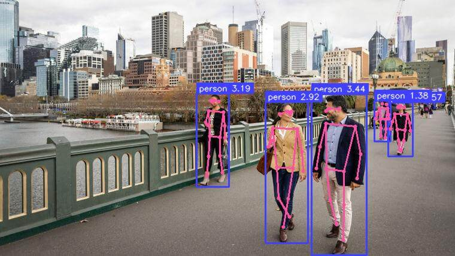
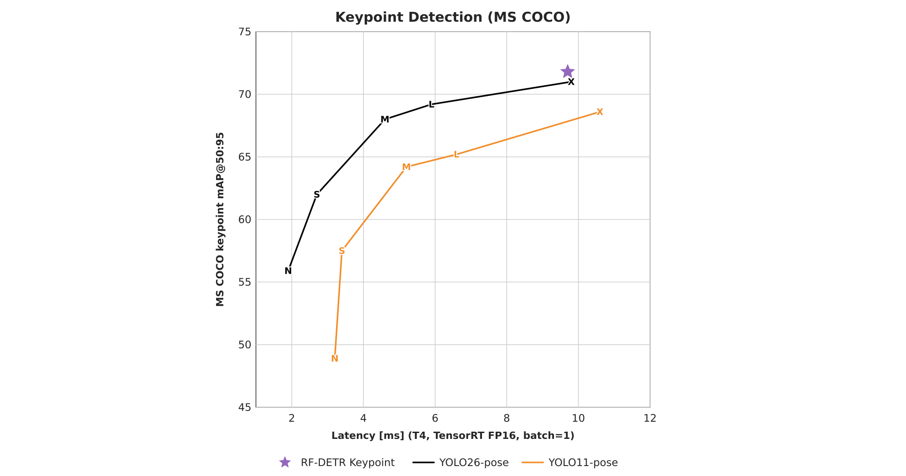
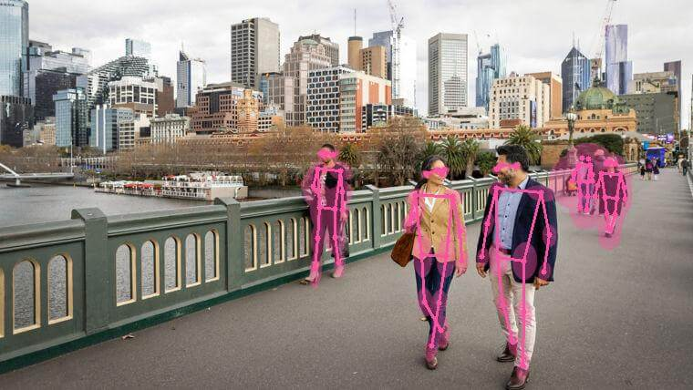

# Run an RF-DETR Keypoint Model

RF-DETR Keypoint is a real-time transformer architecture for keypoint detection, built on a DINOv2 vision transformer backbone. The preview model is pretrained on the Microsoft COCO dataset and predicts 17 body keypoints per detected person.



!!! note "Preview model"

    `RFDETRKeypointPreview` is an early-access release. Fine-tuning on custom keypoint datasets is the primary intended use case. See [Keypoint Preview Parameters](../train/training-parameters.md#keypoint-preview-parameters) for training configuration. API surface and checkpoint weights may change before the stable release.

## Pre-trained Checkpoints

RF-DETR Keypoint outperforms YOLO26-pose X and YOLO11-pose X at comparable latency on MS COCO; the chart and the official numbers are on the [Benchmarks](../benchmarks.md#keypoints) page.

{ width=560 }

<!-- COPIES: the three AP columns come from the results table of docs/cookbooks/coco-accuracy.ipynb (one run, provenance in the note below); params and resolution repeat the Keypoints table of docs/learn/benchmarks.md. -->

|       Model        | PyTorch FP32 keypoint AP<sub>50:95</sub> | TensorRT FP16 keypoint AP<sub>50:95</sub> | TensorRT INT8 keypoint AP<sub>50:95</sub> | Params (M) | Resolution |  License   |
| :----------------: | :--------------------------------------: | :---------------------------------------: | :---------------------------------------: | :--------: | :--------: | :--------: |
| Keypoint (Preview) |                   71.8                   |                   71.7                    |                   71.1                    |    40.7    |  576x576   | Apache 2.0 |

> Keypoint AP is OKS-based, with the standard COCO 17-keypoint sigmas, on COCO val2017 person keypoints.

--8<-- "docs/snippets/reproduced-coco-ap.md"

## Fastest Configuration on NVIDIA GPUs

The configuration with the lowest end-to-end latency on four NVIDIA GPUs, batch 1. Run the [latency cookbook](../../../cookbooks/measure-latency/) on your own GPU to find yours.

<!-- COPIES: every number comes from the results of docs/cookbooks/measure-latency.ipynb (HARDWARE = "cuda", one run per GPU, provenance in the note below). -->

=== "Tesla T4"

    |        Size        | PyTorch CUDA graph FP16 | TensorRT FP16 | TensorRT FP16 graph |   TensorRT INT8   | TensorRT INT8 graph |
    | :----------------: | :---------------------: | :-----------: | :-----------------: | :---------------: | :-----------------: |
    | Keypoint (Preview) |      20.33 (22.75)      | 18.76 (19.88) |    19.07 (19.91)    | **16.98 (18.02)** |    17.32 (18.29)    |

=== "NVIDIA L4"

    |        Size        | PyTorch CUDA graph FP16 | TensorRT FP16 | TensorRT FP16 graph | TensorRT INT8 | TensorRT INT8 graph |
    | :----------------: | :---------------------: | :-----------: | :-----------------: | :-----------: | :-----------------: |
    | Keypoint (Preview) |      9.95 (10.62)       | 9.28 (10.17)  |     8.78 (9.15)     |  8.80 (9.34)  |   **8.40 (9.24)**   |

=== "A100"

    |        Size        | PyTorch CUDA graph FP16 | TensorRT FP16 | TensorRT FP16 graph | TensorRT INT8 | TensorRT INT8 graph |
    | :----------------: | :---------------------: | :-----------: | :-----------------: | :-----------: | :-----------------: |
    | Keypoint (Preview) |       7.95 (8.30)       |  8.09 (8.55)  |   **7.14 (7.57)**   |  8.10 (8.67)  |     7.47 (8.02)     |

=== "RTX PRO 6000"

    |        Size        | PyTorch CUDA graph FP16 | TensorRT FP16 | TensorRT FP16 graph | TensorRT INT8 | TensorRT INT8 graph |
    | :----------------: | :---------------------: | :-----------: | :-----------------: | :-----------: | :-----------------: |
    | Keypoint (Preview) |       4.30 (4.40)       |  3.68 (3.78)  |     3.40 (3.48)     |  3.56 (3.64)  |   **3.24 (3.31)**   |

Each cell is median ms (p95): the median latency in milliseconds, with the 95th percentile of the same 500 calls, also in milliseconds, in brackets. Lower is better, and the lowest median of each row is in bold. The configurations are explained in the note below.

INT8 graph is fastest on the RTX PRO 6000 (3.24 ms) and the L4 (8.40 ms), TensorRT INT8 on the T4 (16.98 ms) and FP16 graph on the A100 (7.14 ms). On the L4, FP16 graph (8.78 ms) and INT8 (8.80 ms) are within 5% of INT8 graph, and on the A100 INT8 graph (7.47 ms) is 4.6% behind FP16 graph.

## Fastest Configuration on Apple Silicon

The configuration with the lowest end-to-end latency on an Apple M4 Max, batch 1. Run the [latency cookbook](../../../cookbooks/measure-latency/) on your own device to find yours.

<!-- COPIES: every number comes from the results table of docs/cookbooks/measure-latency.ipynb (HARDWARE = "apple", one run, provenance in the note below). -->

|        Size        | PyTorch inductor FP32 | PyTorch inductor FP16 | PyTorch TorchScript FP16 |  CoreML FP32  |  CoreML FP16  | CoreML GPU FP32 |  CoreML GPU FP16  |
| :----------------: | :-------------------: | :-------------------: | :----------------------: | :-----------: | :-----------: | :-------------: | :---------------: |
| Keypoint (Preview) |     26.32 (27.01)     |     23.55 (24.08)     |      26.04 (26.55)       | 24.75 (25.12) | 75.02 (78.57) |  24.84 (25.47)  | **21.34 (21.63)** |

Each cell is median ms (p95): the median latency in milliseconds, with the 95th percentile of the same 500 calls, also in milliseconds, in brackets. Lower is better, and the lowest median is in bold.

The FP32 configurations are about 16% slower: CoreML FP32 takes 24.75 ms and CoreML GPU FP32 takes 24.84 ms.

--8<-- "docs/snippets/reproduced-latency.md"

--8<-- "docs/snippets/license-yolo-note.md"

## Run on an Image

Perform inference on an image using the `rfdetr` package. `model.predict()` returns an [`sv.KeyPoints`](https://supervision.roboflow.com/latest/keypoint/core/) object containing skeleton coordinates and per-keypoint confidence scores for each detected person.

=== "rfdetr"

    ```python
    import cv2
    import supervision as sv
    from rfdetr import RFDETRKeypointPreview

    model = RFDETRKeypointPreview()

    image_bgr = cv2.imread("/path/to/image.jpg")
    image_rgb = cv2.cvtColor(image_bgr, cv2.COLOR_BGR2RGB)
    key_points = model.predict(image_rgb, threshold=0.5)

    annotated_image = sv.VertexAnnotator().annotate(image_rgb, key_points)
    ```



## Understanding the Output

`model.predict()` returns an `sv.KeyPoints` object. The fields most commonly used downstream:

| Field                             | Shape          | Description                                                                                                                                                                                                                                                                                                                                                                                                                                                                                                                   |
| --------------------------------- | -------------- | ----------------------------------------------------------------------------------------------------------------------------------------------------------------------------------------------------------------------------------------------------------------------------------------------------------------------------------------------------------------------------------------------------------------------------------------------------------------------------------------------------------------------------- |
| `key_points.xy`                   | `(N, K, 2)`    | Pixel coordinates of each keypoint per detected instance                                                                                                                                                                                                                                                                                                                                                                                                                                                                      |
| `key_points.keypoint_confidence`  | `(N, K)`       | Per-keypoint findability score; use to filter low-confidence points                                                                                                                                                                                                                                                                                                                                                                                                                                                           |
| `key_points.detection_confidence` | `(N,)`         | Per-instance detection score; this is what `threshold` filters on. For keypoint models it includes the default uncertainty fusion term normalized to `[0, 1)`.                                                                                                                                                                                                                                                                                                                                                                |
| `key_points.class_id`             | `(N,)`         | Model label ID for each detection. COCO-pretrained checkpoints use sparse COCO category IDs (1–90). Fine-tuned active-first keypoint checkpoints use normal 0-based class IDs; in the one-class preview setup, `class_id=0` is the foreground class and `class_id=1` is `"__background__"`. Legacy background-first keypoint checkpoints use slot 0 as `"__background__"` and start foreground classes at slot 1. Use `key_points.data["class_name"]` for name resolution rather than indexing your class list by `class_id`. |
| `key_points.data["class_name"]`   | `(N,)`         | Class names resolved from `class_id`; prefer this over indexing a class-name list directly.                                                                                                                                                                                                                                                                                                                                                                                                                                   |
| `key_points.data["xyxy"]`         | `(N, 4)`       | Bounding box for each detected instance in `[x1, y1, x2, y2]` format                                                                                                                                                                                                                                                                                                                                                                                                                                                          |
| `key_points.data["source_image"]` | list of arrays | Source frame stored once per detection; all N entries are the same array — use `[0]` to access it                                                                                                                                                                                                                                                                                                                                                                                                                             |

`K=17` for the pretrained COCO person-keypoint preview checkpoint. Fine-tuned checkpoints use the keypoint count from their dataset schema, so custom keypoint datasets can return any `K` supported by their COCO keypoint annotations.

Keypoints with `visible=False` are skipped by supervision annotators. To hide low-confidence joints manually, threshold `key_points.keypoint_confidence` and set matching entries to `False` in `key_points.visible`.

For fine-tuning on a custom keypoint dataset, see [Keypoint preview custom datasets](../train/index.md#keypoint-preview-custom-datasets).

## Run on video, webcam, or RTSP stream

!!! tip "Built-in video and stream sources"

    `RFDETRInference(model).predict()` reads video files, video URLs, webcams, RTSP streams, and YouTube directly and can yield results lazily with `stream=True`. See [Run on Videos and Streams](videos-and-streams.md). The examples below keep full control of decoding and display with OpenCV.

These examples use OpenCV for decoding and display. Replace `<SOURCE_VIDEO_PATH>`, `<WEBCAM_INDEX>`, and `<RTSP_STREAM_URL>` with your inputs. `<WEBCAM_INDEX>` is usually `0` for the default camera.

=== "video"

    ```python
    import cv2
    import supervision as sv
    from rfdetr import RFDETRKeypointPreview

    model = RFDETRKeypointPreview()

    video_capture = cv2.VideoCapture("<SOURCE_VIDEO_PATH>")
    if not video_capture.isOpened():
        raise RuntimeError("Failed to open video source: <SOURCE_VIDEO_PATH>")

    while True:
        success, frame_bgr = video_capture.read()
        if not success:
            break

        frame_rgb = cv2.cvtColor(frame_bgr, cv2.COLOR_BGR2RGB)
        key_points = model.predict(frame_rgb, threshold=0.5)

        annotated_frame = sv.VertexAnnotator().annotate(frame_bgr, key_points)

        cv2.imshow("RF-DETR Keypoint Video", annotated_frame)
        if cv2.waitKey(1) & 0xFF == ord("q"):
            break

    video_capture.release()
    cv2.destroyAllWindows()
    ```

=== "webcam"

    ```python
    import cv2
    import supervision as sv
    from rfdetr import RFDETRKeypointPreview

    model = RFDETRKeypointPreview()

    WEBCAM_INDEX = 0  # Change this to the desired webcam index (e.g., 1, 2, ...)
    video_capture = cv2.VideoCapture(WEBCAM_INDEX)
    if not video_capture.isOpened():
        raise RuntimeError(f"Failed to open webcam: {WEBCAM_INDEX}")

    while True:
        success, frame_bgr = video_capture.read()
        if not success:
            break

        frame_rgb = cv2.cvtColor(frame_bgr, cv2.COLOR_BGR2RGB)
        key_points = model.predict(frame_rgb, threshold=0.5)

        annotated_frame = sv.VertexAnnotator().annotate(frame_bgr, key_points)

        cv2.imshow("RF-DETR Keypoint Webcam", annotated_frame)
        if cv2.waitKey(1) & 0xFF == ord("q"):
            break

    video_capture.release()
    cv2.destroyAllWindows()
    ```

=== "stream"

    ```python
    import cv2
    import supervision as sv
    from rfdetr import RFDETRKeypointPreview

    model = RFDETRKeypointPreview()

    video_capture = cv2.VideoCapture("<RTSP_STREAM_URL>")
    if not video_capture.isOpened():
        raise RuntimeError("Failed to open RTSP stream: <RTSP_STREAM_URL>")

    while True:
        success, frame_bgr = video_capture.read()
        if not success:
            break

        frame_rgb = cv2.cvtColor(frame_bgr, cv2.COLOR_BGR2RGB)
        key_points = model.predict(frame_rgb, threshold=0.5)

        annotated_frame = sv.VertexAnnotator().annotate(frame_bgr, key_points)

        cv2.imshow("RF-DETR Keypoint RTSP", annotated_frame)
        if cv2.waitKey(1) & 0xFF == ord("q"):
            break

    video_capture.release()
    cv2.destroyAllWindows()
    ```

## Visualization

`supervision` provides several keypoint annotators. Choose based on what you want to draw.

=== "EdgeAnnotator"

    Draws skeleton edges (lines between connected joints). Edges where either endpoint has `visible=False` are skipped automatically.

    ```python
    annotated = sv.EdgeAnnotator().annotate(image, key_points)
    ```

=== "VertexAnnotator"

    Draws a dot at each keypoint. Keypoints with `visible=False` are skipped automatically.

    ```python
    annotated = sv.VertexAnnotator().annotate(image, key_points)
    ```

=== "VertexEllipseAnnotator"

    Draws covariance ellipses from `key_points.data["covariance"]`, giving a visual footprint of per-keypoint uncertainty.

    ```python
    annotated = sv.VertexEllipseAnnotator().annotate(image, key_points)
    ```

=== "VertexEllipseHaloAnnotator"

    Draws the same covariance uncertainty with a soft halo for improved contrast on busy backgrounds.

    ```python
    annotated = sv.VertexEllipseHaloAnnotator().annotate(image, key_points)
    ```
